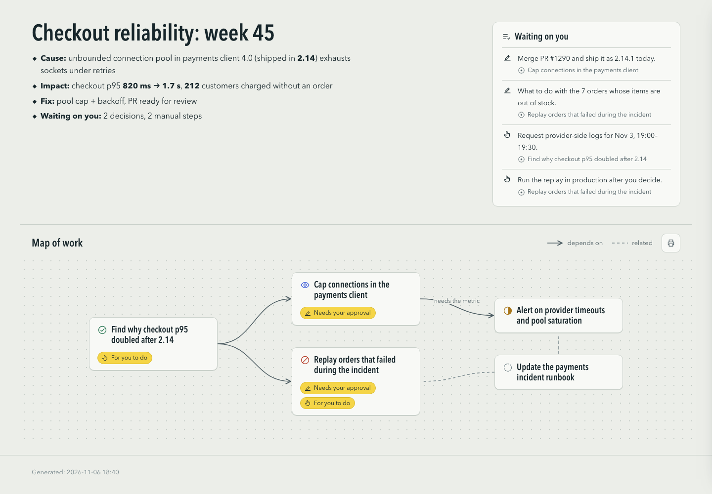
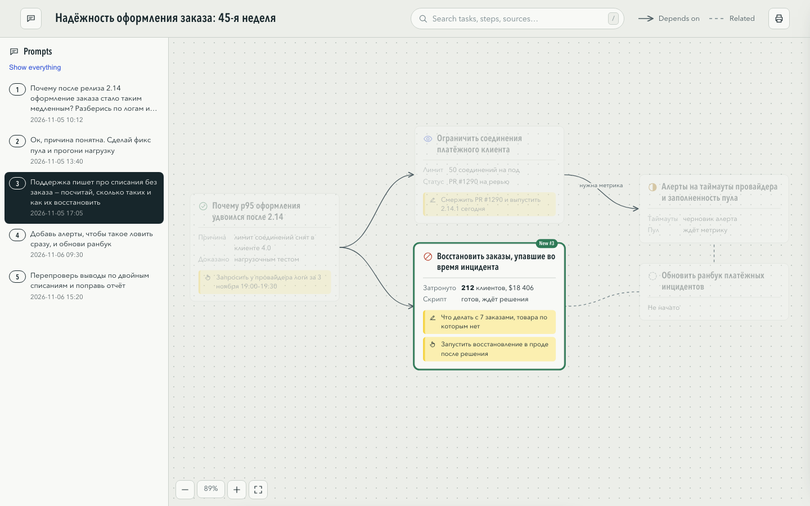
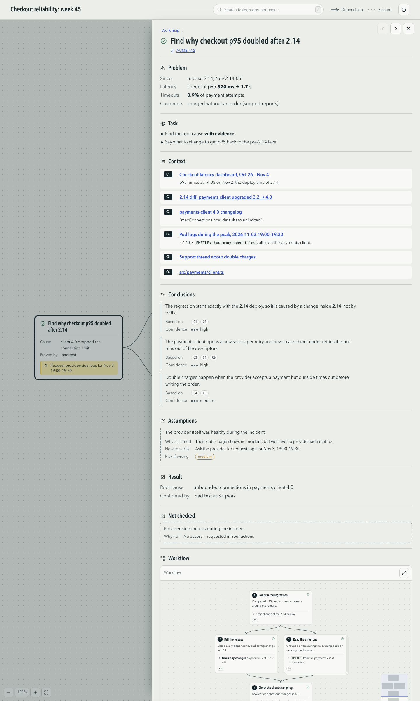

# structured-report

An agent skill that turns finished work into a **structured, interactive HTML report** — a map of
tasks you can click into, where every claim says how it is known.



**Work map** — the only thing on the first page, sized to the window: each task is a card with
its status, a short brief, and what waits on the reader; arrows for dependencies, dashed lines for
related work. Large maps behave like a canvas: drag or two-finger scroll to move, pinch
or Ctrl/⌘+scroll to zoom, a minimap to jump around.

**Task report** (click a task) — in a fixed order:

| Section | What it holds |
|---|---|
| Problem | what is wrong, for whom |
| Task | what done means |
| Context gathered | the sources actually looked at, with links |
| What I concluded | conclusions, each citing the context it rests on, with confidence |
| What I assumed | unverified assumptions, with how to check them and the risk if wrong |
| Result | typed outcomes: added, changed, fixed, verified, measured, decided — with links |
| Workflow | a canvas of the stages; **each stage opens its own report in the same structure**, to any depth |
| Needs your approval | decisions only the reader can make |
| For you to do | steps only the reader can take, with copyable commands |

**Structure vs. content.** The template owns the structure — section names (always English),
order, statuses and icons — and the agent supplies only content (any language) through
`{{placeholders}}`. Facts, conclusions and assumptions are drawn with different rules (solid, double, dashed) so a
reader can tell at a glance what was checked and what was guessed.





The output is a single offline HTML file: no CDN, no fonts to download, no tracking. Inline SVG
icons, keyboard navigation, deep links (`#task=<id>`), and a print view that prints every task.

## Living reports

- **Prompts rail** — bind a Claude Code session (`track.py start`) and a `UserPromptSubmit` hook logs
  every prompt; each rebuild stamps the blocks that appeared or changed. Pick a prompt to see what
  it produced.
- **Answer in the report** — the *Needs approval* section has inputs; its *Send to agent* posts them to
  a local answer service, and the session picks them up as its next prompt (a background
  `track.py wait`, or the Stop / UserPromptSubmit hooks).
- **Copy as Markdown** — every report, card, section, item, step and prompt has a copy button.
- **Search** — `/` or ⌘K, across every task and stage.
- **Link in the session** — `scripts/statusline.py` adds the report to the Claude Code status line,
  under the input: a clickable link that opens it, and how many questions are waiting.
- **A report for every session, automatically** — `scripts/autobind.py install` wires a
  `SessionStart` hook (per repo, or `--global`): each new session gets its own living report in
  `~/Reports/sessions/<repo>/`, bound and built before the first prompt.
- **Beside the session in PyCharm / WebStorm** — when the session runs inside a JetBrains IDE (its
  agent panel or terminal), the report of the *active* session is shown in the editor window to the
  right of it — a split *Session | Report*. It appears after the first prompt, follows you when you
  switch sessions and reloads on every rebuild. No plugin: the IDE's own `ideScript` command runs
  `scripts/ide-open.groovy` inside the running IDE. For smooth scrolling it switches the IDE's
  built-in browser to in-process mode (registry `ide.browser.jcef.out-of-process.enabled = false`,
  applies after an IDE restart; a notification says so).
- **Checks** — `verified` needs proof (`how`), finished work must say what was *not checked*,
  next steps are planned stages, and the build refuses anything that looks like a secret.

## Install

With the [skills CLI](https://skills.sh):

```bash
npx skills add DELTA37/structured-report
```

Or copy the skill folder into your agent's skills directory, e.g. for Claude Code:

```bash
git clone https://github.com/DELTA37/structured-report
cp -r structured-report/skills/structured-report ~/.claude/skills/
```

### A living report for every Claude Code session

```bash
cd your-repo
python3 ~/.claude/skills/structured-report/scripts/autobind.py install            # this repo (.claude/settings.local.json)
python3 ~/.claude/skills/structured-report/scripts/autobind.py install --global   # every repo (~/.claude/settings.json)
python3 ~/.claude/skills/structured-report/scripts/autobind.py status | uninstall
```

Optionally add `scripts/statusline.py` to your status line for a clickable link to the report.

## Use

Ask your agent for a report on the work — *"write a structured report of what you did today"*,
*"отчёт по работе"*. The agent fills a JSON file and runs:

```bash
python3 skills/structured-report/scripts/build.py report.json   # → report.html
```

Try it on the bundled example:

```bash
python3 skills/structured-report/scripts/build.py skills/structured-report/examples/example.json
open skills/structured-report/examples/example.html
```

The data format is documented in [`references/schema.md`](skills/structured-report/references/schema.md).
Content can be in any language; structure labels stay English. See `examples/example.ru.json`.

Requires Python 3.9+ (standard library only) and any modern browser.

## License

MIT
